<p align="center">
  
</p>

<h1 align="center">Almanac</h1>

<p align="center">
  <b>Your mail, calendars and contacts in one fast, friendly desktop app.</b><br>
  For Linux, Windows and macOS. Works with Gmail, Outlook, iCloud, Fastmail and any IMAP server.
</p>

<p align="center">
  <a href="https://github.com/benwbooth/almanac/releases/latest"><b>Download</b></a> ·
  <a href="https://benwbooth.github.io/almanac/">Website</a> ·
  <a href="#screenshots">Screenshots</a> ·
  <a href="#building-from-source">Build from source</a>
</p>

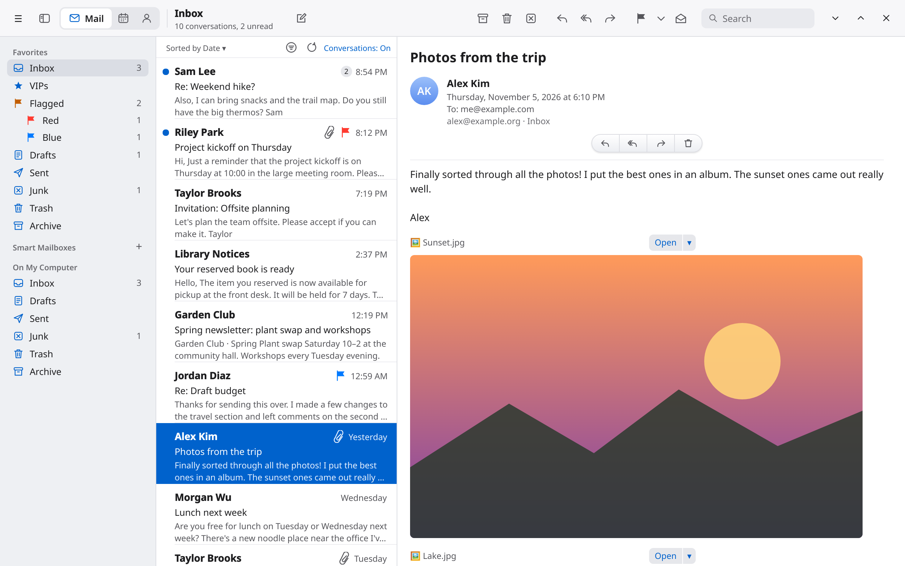

## Why Almanac

- **Everything in one place.** Mail, calendars and contacts side by side, switching with one click.
- **Your accounts, directly.** Almanac talks to your mail and calendar servers itself (IMAP, SMTP,
  CalDAV, CardDAV). There's no middleman service, and your passwords stay in your system keychain.
- **Easy sign-in.** Google, Microsoft, Yahoo, AOL, iCloud, Fastmail, Proton (through Bridge), Zoho,
  GMX, mail.com, Yandex, mailbox.org, Posteo, or any other mail account.
- **Fast with big mailboxes.** Hundreds of thousands of messages open in a blink and scroll smoothly.
  All your mail can be kept on your computer for offline reading and instant search.
- **Writing that feels good.** Rich text, tables, lists, pasted Markdown, and code blocks with syntax
  highlighting. Spelling and grammar checks run offline.
- **Organized your way.** Conversations, VIPs, coloured flags, smart mailboxes, reminders
  ("Remind me tomorrow morning"), mute, block sender, and swipe gestures on the trackpad.
- **A real calendar.** Day, week, month and year views. You can accept invitations right from the
  message, and join Zoom with one click.
- **Contacts that stay in sync**, with groups and CardDAV.
- **Moving in is easy.** Bring your mail over from Thunderbird or Mailspring.
- **Light and dark**, following your system.

## Install

Grab the latest version from the [Releases page](https://github.com/benwbooth/almanac/releases/latest).

| System | Download |
| --- | --- |
| **Windows** | `Almanac-…-windows-x64-setup.exe` (installer), or `Almanac-…-windows-x64-portable.zip` (no install needed: unzip and run `Almanac.exe`) |
| **macOS** (Apple Silicon) | `Almanac-…-macos-arm64.dmg` |
| **macOS** (Intel) | `Almanac-…-macos-x86_64.dmg` |
| **Linux** (any distro) | `Almanac-…-x86_64.AppImage`: make it executable and run it |
| **Linux** (Flatpak) | `Almanac-…-x86_64.flatpak`, or use the Flatpak repository below |

**Homebrew** (macOS):

```sh
brew install --cask benwbooth/tap/almanac
```

**Flatpak** (Linux), with updates:

```sh
flatpak install --user https://benwbooth.github.io/almanac/flatpak/almanac.flatpakref
```

> The macOS app is not notarized by Apple yet. The Homebrew cask takes care of that for you. If you
> install from the `.dmg` and macOS refuses to open it, right-click Almanac in Applications and choose
> **Open**.

## Screenshots

<table>
  <tr>
    <td>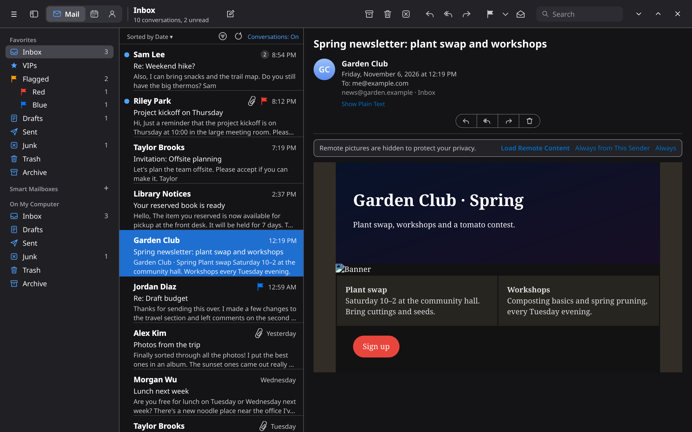<br><sub>Mail in dark mode</sub></td>
    <td>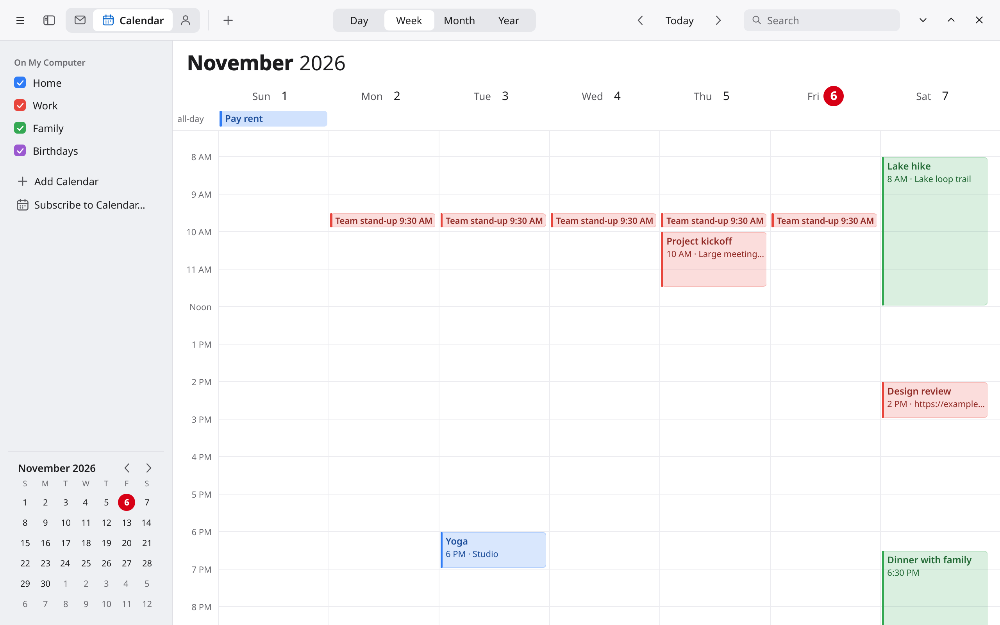<br><sub>Calendar: week view</sub></td>
  </tr>
  <tr>
    <td>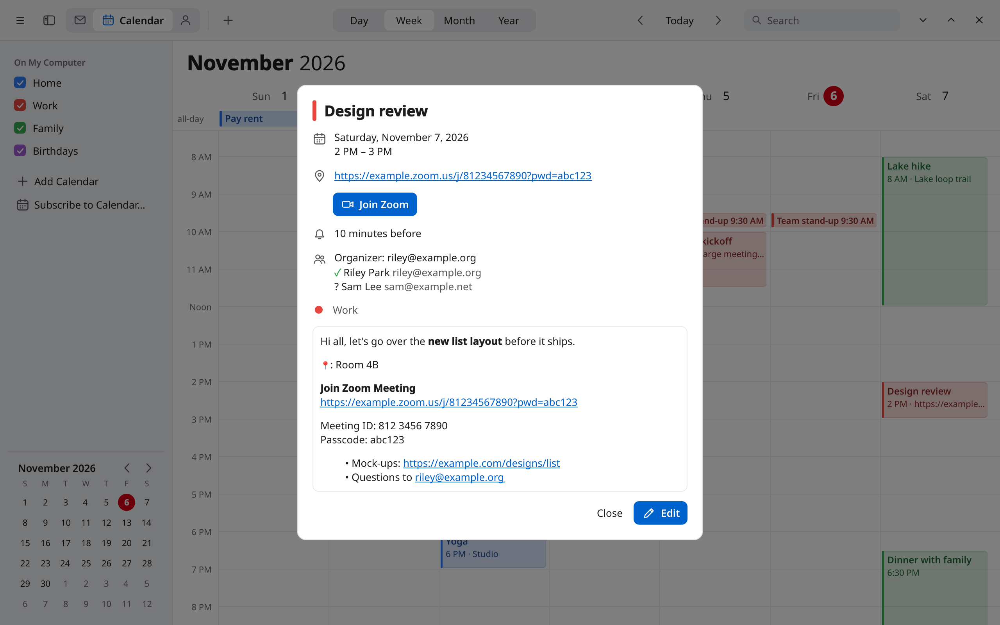<br><sub>Event details, one-click Zoom</sub></td>
    <td>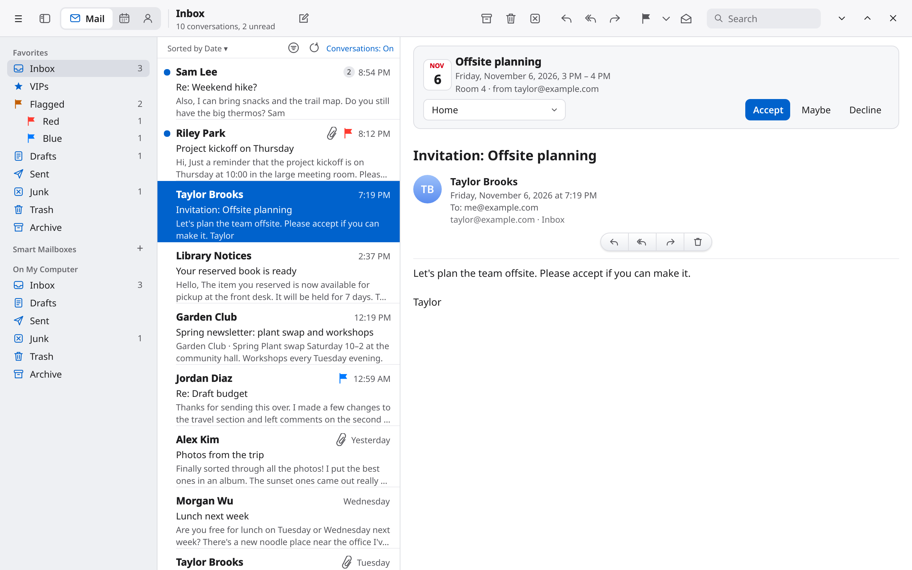<br><sub>Answer invitations from the message</sub></td>
  </tr>
  <tr>
    <td>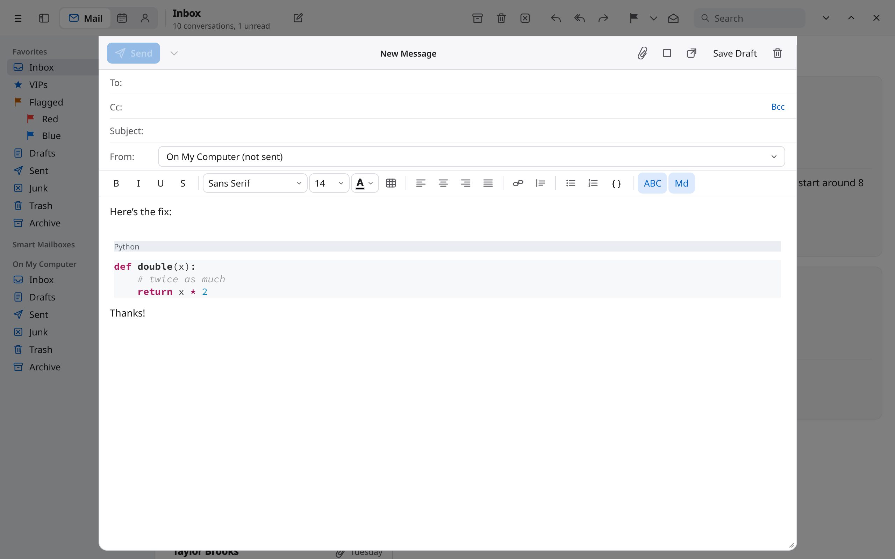<br><sub>Code blocks with syntax highlighting</sub></td>
    <td>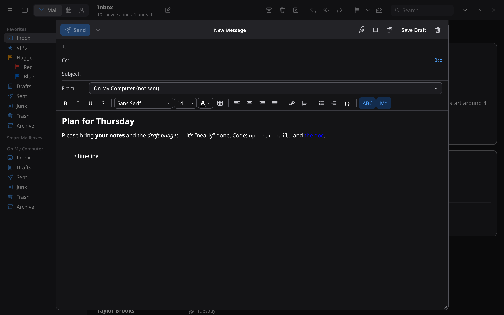<br><sub>Markdown becomes formatting</sub></td>
  </tr>
  <tr>
    <td>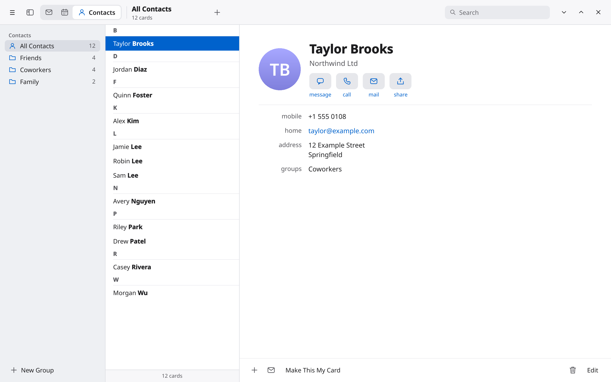<br><sub>Contacts with groups</sub></td>
    <td>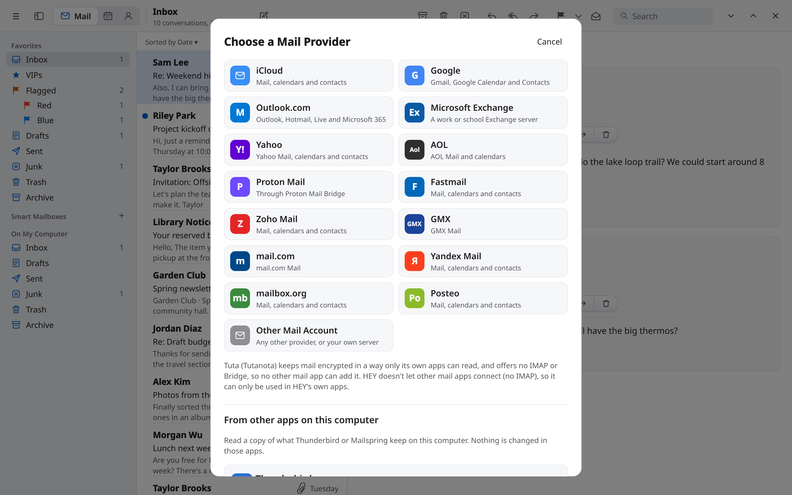<br><sub>Add almost any account</sub></td>
  </tr>
  <tr>
    <td>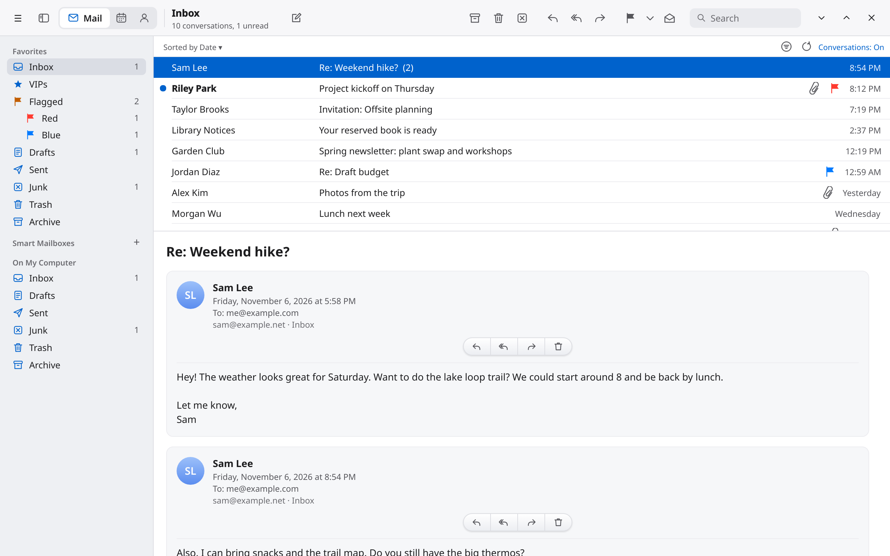<br><sub>Classic layout</sub></td>
    <td>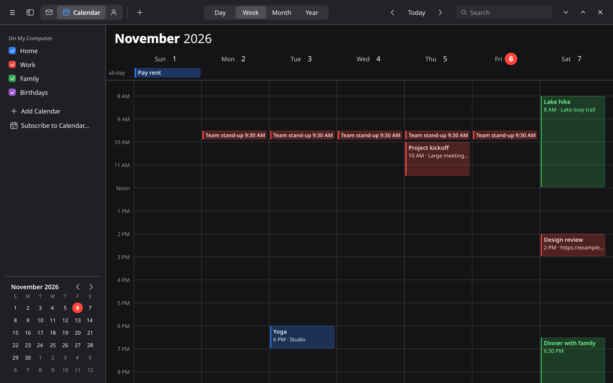<br><sub>Calendar in dark mode</sub></td>
  </tr>
</table>

The screenshots use made-up sample data. To look around without adding an account, choose
**Try with Sample Data** on the welcome screen.

## Building from source

Almanac is written in **Rust**, with a **Qt 6 / Qt Quick** interface joined through
[cxx-qt](https://github.com/KDAB/cxx-qt). Qt WebEngine shows message bodies.

### With Nix

```sh
nix develop      # a shell with Rust and Qt 6
cargo run

nix build        # or build the package; the binary lands in ./result/bin
```

`flake.nix` follows `nixos-unstable`, pinned in `flake.lock`; `nix flake update` moves the pin.

### Without Nix

Install Rust and Qt 6 (qtbase, qtdeclarative, qtsvg, qtwebengine, qtwebchannel, qtpositioning).
Then either set `QMAKE` to your Qt 6 `qmake`, or make `.qt-env` a symlink to your Qt install folder:

```sh
QMAKE=/path/to/qt6/bin/qmake cargo run --release
```

### Development loop

```sh
scripts/dev.sh              # rebuild and restart Almanac on every change
scripts/dev.sh --scratch    # same, with a throwaway data folder instead of your mail
scripts/dev.sh --release -- --some-almanac-flag
```

It watches `src/`, `qml/`, `icons/`, `include/`, `build.rs` and `Cargo.toml` with watchexec. It only
replaces the running Almanac once a build succeeds. App output goes to `target/dev-almanac.log`.
The script enters `nix develop` by itself when watchexec or Qt aren't on the PATH.

### Screenshots

`almanac --screenshot out.png --sample --show <view>` draws a window off-screen with sample data
and saves a picture, for example with `--show newsletter`, `--show event-details`,
`--open calendar` or `--theme dark`. The pictures above were made this way, with
`QT_SCALE_FACTOR=2`.

### Release builds

Publishing a GitHub release runs `.github/workflows/release.yml`. It builds the Windows installer
and portable zip, the macOS disk images, the AppImage and the Flatpak bundle, and attaches them to
the release. It then publishes the website and Flatpak repository on GitHub Pages
(`.github/workflows/pages.yml`, from `docs/`). It also updates the Homebrew cask in
`benwbooth/homebrew-tap` when the `HOMEBREW_TAP_TOKEN` secret is set. Packaging files live in
`packaging/`; after changing `icons/almanac.svg`, run `scripts/make-icons.py` to remake the `.ico`
and `.icns`. You can run the workflow by hand from the Actions tab to try the builds without
publishing anything.

### OAuth clients

Sign-in with Google, Yahoo and AOL needs an OAuth client of your own. You can create one from the
Sign-in Setup screen inside the app. Or bake one in at build time with
`ALMANAC_GOOGLE_CLIENT_ID` / `ALMANAC_GOOGLE_CLIENT_SECRET` (and the `YAHOO` / `AOL` equivalents).
